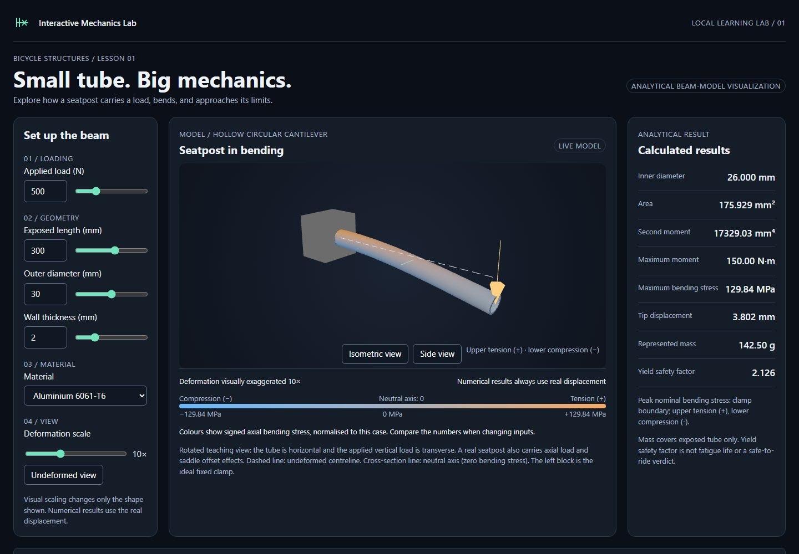
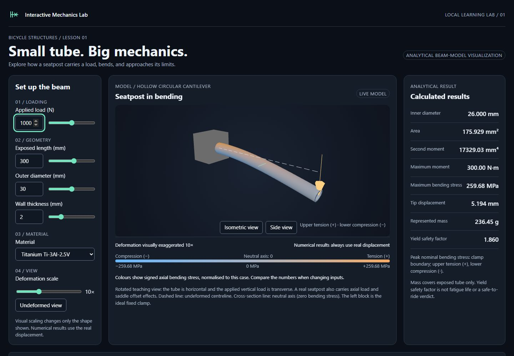
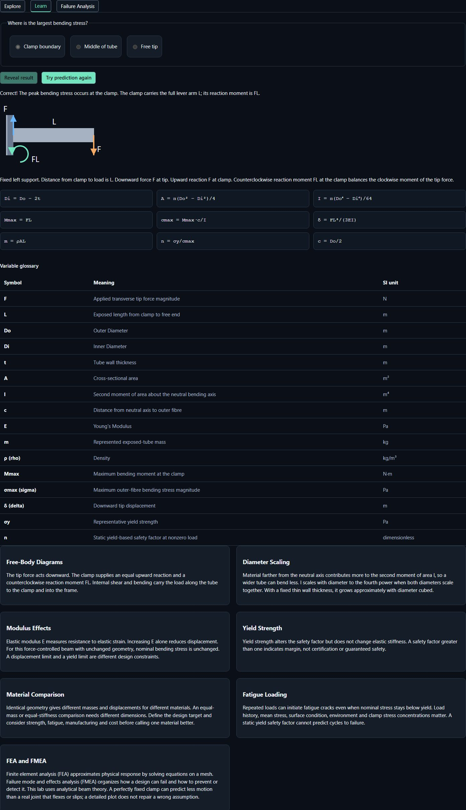
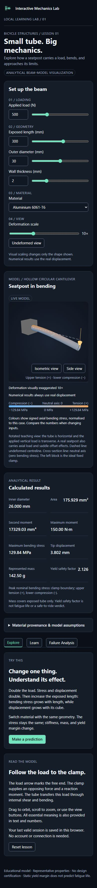

# Interactive Mechanics Lab

**Early preview / MVP** for students, educators, and curious cyclists learning structural mechanics. Change a bicycle seatpost's geometry, material, and load; see the calculated response and learn why it changes.

**[Interactive demo](https://nishdel.github.io/InteractiveMechanicsLab/)** · [Calculation validation](docs/PHYSICS-VALIDATION.md) · [Architecture](docs/ARCHITECTURE.md)

> This is a sanitized local publication candidate with fresh Git history. No upload or deployment is authorized in the current privacy task; the demo has not been verified live. The project owner has not completed manual acceptance testing. This is an educational analytical static-beam model, not a certified engineering product or a finite-element solver.

## See the lesson


_Default case: 500 N, 300 mm exposed length, 30 mm diameter, 2 mm wall, aluminium 6061-T6. Stress is 129.84 MPa; displacement is 3.802 mm._


_At 1000 N with the same geometry and titanium selected, nominal stress is 259.68 MPa and displacement is 5.194 mm. At equal load and geometry, material modulus changes displacement; material selection alone does not change this model's bending stress._


_Predict the highest-stress location, reveal the answer, then connect the free-body diagram and equations to the results._


_A narrow layout stacks the controls, visualization and results. The wide FMEA table scrolls within its own region._

These are actual production-build browser captures, taken after the 3D scene rendered. Regenerate them with the commands below; no mockups or generated imagery are used.

## Try it

1. In **Explore**, adjust load (N), exposed length, diameter and wall thickness (mm). Numeric fields also let you try invalid geometry and see the resulting explanation.
2. Switch among sourced steel, aluminium and titanium examples. Compare stiffness, mass and yield margin, rather than assuming identical geometry makes a fair material comparison.
3. Rotate the 3D view or use the camera buttons. The load arrow, fixed clamp, neutral axis, signed stress legend and text identify the load path and tension/compression sides.
4. Change the deformation multiplier or choose **Undeformed view**. Scaling changes only the displayed shape; calculated displacement stays unchanged. Multipliers above 1 are explicitly labelled exaggerated.
5. Open **Learn** for the prediction activity, formulas, variables and units; open **Failure Analysis** for five curated design-FMEA examples. Learning and FMEA content are deterministic, not generated dynamically.

The app saves the last valid session in this browser. It needs no account, backend, runtime AI, external font, telemetry or cloud calculation service. A locally built copy works without internet; optional source links open online references. This is a browser app, not an installed PWA.

## Run locally

Use Node.js **24** and pnpm **11.25.0**. Clone/download this repository, then run from its directory:

```sh
pnpm install --frozen-lockfile
pnpm dev
```

Open `http://127.0.0.1:5179/`. For the static production build:

```sh
pnpm build
pnpm preview
```

Open `http://127.0.0.1:4179/`. Servers bind only to loopback. Opening `dist/index.html` directly with `file://` is unsupported; use the preview server.

### Windows storage launcher

From PowerShell, in your checkout, use the existing **PowerShell 7** launcher:

```powershell
pwsh -NoProfile -File .\scripts\project.ps1 install --frozen-lockfile
pwsh -NoProfile -File .\scripts\project.ps1 dev
# Or build, then preview:
pwsh -NoProfile -File .\scripts\project.ps1 build
pwsh -NoProfile -File .\scripts\project.ps1 preview
```

In Firefox, press Ctrl+L and enter the local URL. The launcher keeps browser binaries, profiles, temporary files and package-manager state under `.cache`; project settings also keep dependency storage/cache there. Put the checkout on D: to keep these project files on D:. It restores the caller's environment and does not change shared settings, execution policies or networking. Use this launcher for browser installation and tests too.

## Checks and screenshots

```sh
pnpm lint
pnpm format:check
pnpm typecheck
pnpm test:unit
pnpm build
pnpm exec playwright install chromium firefox webkit
pnpm test:e2e
```

On Windows, prefix the arguments with `pwsh -NoProfile -File .\scripts\project.ps1`, for example `pwsh -NoProfile -File .\scripts\project.ps1 test:e2e`. Browser installation is a development-only download. Firefox and Chromium exercise the critical interactions and 3D camera controls; WebKit runs the calculation/learning interactions too. See the [living verification record](docs/PROJECT-HISTORY-AND-MANUAL-TESTING.md) for executed results, remaining manual checks and local-agent provenance. Automated tests do not replace the owner's manual acceptance testing.

To reproduce the Pages subpath locally in PowerShell:

```powershell
$env:VITE_BASE_PATH = '/InteractiveMechanicsLab/'
$env:PLAYWRIGHT_BASE_URL = 'http://127.0.0.1:4179/InteractiveMechanicsLab/'
pwsh -NoProfile -File .\scripts\project.ps1 build
pwsh -NoProfile -File .\scripts\project.ps1 preview
# In another terminal with the same two environment variables:
pwsh -NoProfile -File .\scripts\project.ps1 test:e2e
pwsh -NoProfile -File .\scripts\project.ps1 exec node scripts/capture-publication.mjs
```

The screenshot script writes four optimized JPEGs to `docs/screenshots/`. Unset the two environment variables, or use a fresh terminal, to return to root-path local development. Browser tests can start the preview automatically when it is not already running.

## How it works and what it assumes

React/TypeScript controls → central conversion to SI units → pure, deterministic beam equations → immutable results → numerical panels and a separately scaled React Three Fiber/Three.js visualization. The calculation engine does not import UI code. Material properties live in a versioned JSON catalogue; source notes are also visible in the app.

The uniform hollow tube has a perfectly fixed root and a static transverse point load. The teaching view rotates the seatpost horizontally to make bending visible. It assumes isotropic linear elasticity and small deflection. Calculations use metres, newtons and pascals internally; displayed units include mm, MPa, GPa and grams. Represented mass covers only the exposed tube.

The displayed yield safety factor is **representative yield strength divided by nominal maximum outer-fibre bending stress**. It is a static yield margin for this idealized calculation. It does **not** establish fatigue life, clamp/contact performance, certification, or safe real-world riding. At zero load it is shown as unloaded instead of an infinite design rating.

Material sources: [Reynolds 953 steel](https://www.reynoldstechnology.biz/faqs-on-reynolds-steel-tubing/materials/), [Kaiser 6061-T6 aluminium](https://online.kaiseraluminum.com/depot/PublicProductInformation/Document/1006/Kaiser_Aluminum_Shapes_Soft_Alloy.pdf), and [TIMET annealed Ti-3Al-2.5V](https://www.timet.com/documents/datasheets/alpha-and-beta-alloys/timetal-3-2.5.pdf). Values are representative educational examples, **not certified design allowables**. Range selections, equations, independent benchmark values and tolerances are documented in [Physics validation](docs/PHYSICS-VALIDATION.md).

Known limits: no finite-element solution, detailed clamp contact/crushing, slip, local stress concentrations, axial load, buckling, dynamics or fatigue-life calculation. Curated FMEA highlights some excluded failure mechanisms; it is not calculated risk certification. WebGL is needed for 3D; text/results remain available on rendering failure. The Three.js bundle is relatively large and currently emits a dependency-level clock deprecation notice. Human learner, screen-reader and physical-device testing remain outstanding.

## Publishing future changes

Open a pull request to `main`. The **Verify and deploy Pages** workflow checks formatting, lint, types, unit tests, the production build and browser interactions at `/InteractiveMechanicsLab/`; pull requests do not deploy or receive deployment permissions. After merge, validation runs again on that exact main commit, then only `dist/` is uploaded and deployed through the `github-pages` environment. GitHub Pages must use **GitHub Actions** as its publishing source. No custom domain or laptop tunnel is needed.

## License and notices

No license has been selected for this project's original source; publication does not imply an open-source license. Existing dependency notices are preserved in [third-party notices](public/third-party-notices.txt), which is also included in the deployed build. No new project license or ownership claim is introduced here.
